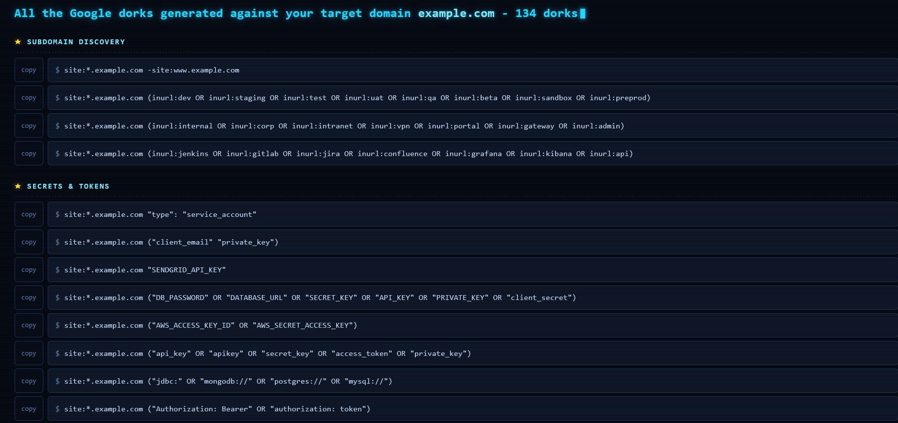
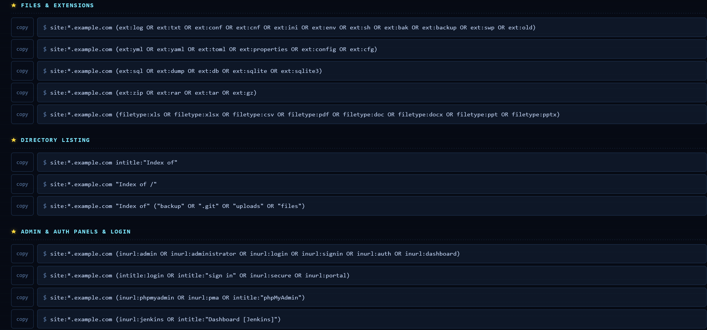

# ReconDork

A bug bounty Google dork generator. Point it at a domain and it builds a clean, dark-themed HTML page of 130+ ready-to-run Google searches — covering secrets, config files, exposed version control, sensitive documents, admin panels, API surfaces, and off-site leaks. Click any dork to run the search, or copy it with one tap. A fast, quiet first step for the recon phase of authorized bug bounty and pentest work.

## Usage

```bash
chmod +x ReconDork.sh

./ReconDork.sh example.com        # search the domain (site:example.com)
./ReconDork.sh -w example.com     # wildcard: search the subdomains (site:*.example.com)
```

Options: `-w` wildcard · `-t` also write a plain-text list · `-o DIR` output directory · `--no-open` don't launch a browser · `-h` help.

Each run writes a timestamped HTML report and opens it in your browser.

## Preview





---

> ⚠️ For authorized security testing only — run these against assets you own or have explicit permission to test.
